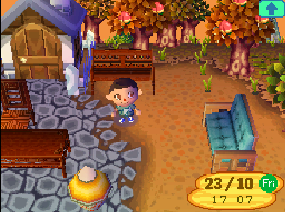
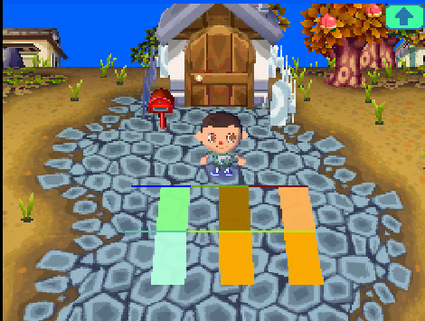
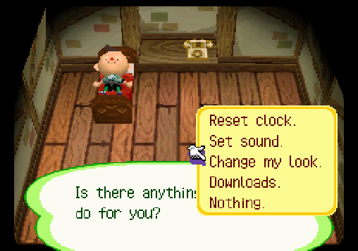
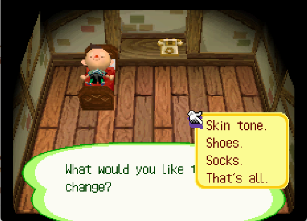
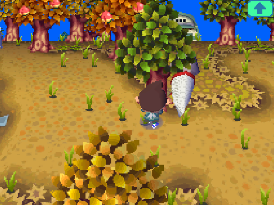

# AC:WW+

**A small quality-of-life hack for *Animal Crossing: Wild World* (Nintendo DS, European and US versions, both US revisions) that
keeps the game's feel.** Furniture outside, transparent patterns, shaking trees with your tools, swapping tools with L/R, and
a few more things I always wanted from Wild World.



> **Status: alpha.** The **European version** runs on real hardware (flashcart) and on emulators, and I play it
> every day. The **US version** (the first release and revision 1) is the same hack moved to the US game: it
> passes the same automated tests in an emulator, but **it hasn't been tried on a real DS yet.** Only a few people have played either so far.
> **Back up your save before you start.**

---

## A note before you start

This started as a personal side project: I wanted to play Wild World the way I always imagined it, and to see
whether these changes would even work on a real DS. They did, people liked the screenshots, so here it is.

**What to expect from me:**
- I'm sharing this **as is**. For me it's done: it has everything I wanted from the game.
- I may fix bugs that come up, and maybe add a small QoL patch here and there, **but I'm not planning further
  development** and can't promise support or timelines. My time goes to freelance work and to a much bigger
  Wild World project.
- **Everything is open.** If you want to take it further (new features, translations, anything),
  please do: fork it, change it, release your own version. The code, the build tools, the tests and my notes on
  how everything works are all here. You don't need my permission.

---

## Features

### Furniture outdoors
Drop furniture from your pockets in town and it stands there as its **real 3D model**, facing the way you were
facing. It's solid, and big pieces (benches, tables, beds) block all of their squares. Pick it up with B as usual.

- Furniture that falls out of a shaken tree still lands as a leaf, like in the original game.
- About 20 different models can show in 3D at once. Beyond that, the farthest pieces show as leaves until you walk
  closer. If the game ever runs short on memory, pieces fall back to leaves instead of crashing.

### Transparent patterns
In the pattern editor, L/R now cycles past the last colour to **transparent**. Designs laid on the ground show the
ground through their transparent pixels. (On clothes they stay black, as in the original.)



### Change your look: skin tone, shoes and socks
The upstairs phone's Service Center has a new **"Change my look."** entry:
- **Skin tone:** pick a lighter or darker base tone. Summer tanning still works and fades back to your choice.
- **Shoes** and **socks:** cycle through colours.

| The new phone menu entry | The choices |
|---|---|
|  |  |

### Shake trees with your tools
With a **net or a fishing rod** equipped, A at a tree shakes it. No more putting the tool away first. With the
net, a bug close by is still caught instead.



### Swap tools with L / R
- **R:** switch to the next tool in your pockets.
- **L:** put your tool away, or take it back out.

### The monkeys can move in
Champ, Nana, Simon, Tammi, Monty and Elise can move into your town like any other villager.

### Nookington's without multiplayer
The last upgrade of Nook's shop no longer needs a purchase by a visitor from another town.

New text is in **English in every language** for now.

---

## How to play it

You need **your own copy** of the game. This repo and its releases contain no game files, only a patch.

1. **Check which version your ROM is**, and get the matching patch from the
   [Releases](https://github.com/migueliranzo/acww-plus/releases) page:

   | Your game | Patch | Base ROM (must match) |
   |---|---|---|
   | Europe | `acww_plus_<version>.bps` | *Animal Crossing - Wild World (Europe) (En,Fr,De,Es,It)*, `ADMP`, CRC32 **`C677970C`** |
   | USA | `acww_plus_<version>_us.bps` | *Animal Crossing - Wild World (USA)*, `ADME`, first release (rev 0), CRC32 **`F24508AA`** |
   | USA, revision 1 | `acww_plus_<version>_us_rev1.bps` | *Animal Crossing - Wild World (USA) (Rev 1)*, `ADME` rev 1, CRC32 **`7E62F586`** |

   The Japanese and Korean versions aren't supported.
2. **Not sure?** Rom Patcher JS shows your ROM's CRC32 when you load it; match it against the table. Both US
   revisions are game code `ADME`, so only the CRC32 tells them apart (rev 1 dumps are often labelled "(Rev 1)" or
   "v1.1").
3. **Patch it:** open [Rom Patcher JS](https://www.marcrobledo.com/RomPatcher.js/) in your browser (or use Flips),
   pick your ROM and the `.bps` file, and apply. A wrong base ROM is refused, so you can't patch the wrong one by
   accident.
4. **Play** the patched ROM on a flashcart, a DSi/3DS homebrew setup or an emulator (melonDS, DeSmuME).

### Saves
- **Your existing save works as is** (EU save with the EU patch, US save with the US patch).
- **Going back to the original game** also works: the save loads and the extras are simply ignored. Shoes and
  socks go back to their normal colours, your skin tone fades back the original way, transparent pattern pixels show
  as black, and outdoor furniture shows as leaves.
- ⚠️ **Before going back, pick up any 2- or 4-square furniture you placed outdoors** (benches, tables, beds).
  Their extra squares hold a marker the original game can't clear, so you couldn't drop anything there.

### Found a bug?
Open an [issue](https://github.com/migueliranzo/acww-plus/issues). Please include:
- what you were doing when it happened;
- what furniture you had outdoors nearby;
- whether you were on a flashcart or an emulator (which one).

Remember the note above: I'll look when I can, but there's no guarantee.

---

## For developers

Everything that went into this is here, including the parts that aren't released. Start with
[`docs/REFERENCES.md`](docs/REFERENCES.md) (memory map, code space, conventions) and the per-feature notes in
[`docs/features/`](docs/features/). Each one explains what the feature does, which game functions it hooks and why.

### How it works, in short
- It's a classic **hook-and-inject** ROM hack, not a decompilation. The game's own code stays as it is. Small C
  functions are compiled with Metrowerks CodeWarrior and placed into free memory. Branches at specific addresses are
  patched to call them: `tools/patches.py` lists every patch, and each one checks the original bytes first.
- **Where the code lives:**
  - The unused tail of the ARM9 instruction memory (ITCM), for code that runs every frame.
  - An 8 KB "code home" just below the game's main memory, created by moving the start of the game's main memory
    area. See [`docs/features/code_home.md`](docs/features/code_home.md).
- Text changes are applied to the game's message files (`tools/file_patches.py`, `tools/bmg_tool.py`).
- Targets: **EU (`ADMP`)**, **US (`ADME` rev 0)** and **US rev 1**. The sources and `tools/patches.py` use EU
  addresses; the US builds map them through `tools/regions/adme.py` / `adme_rev1.py`, generated by
  `tools/remap_region.py` from the games' binaries (`--region us` / `--region us1` on the build, test and patch
  tools; details in [`docs/RELEASE.md`](docs/RELEASE.md)).

### Repository layout
| Path | What |
|---|---|
| `src/` | The C code injected into the game (one file per feature) |
| `src/heap/` | Code that lives in the code home |
| `tools/build_rom.py` | Builds the ROM: compile, link, patch, repack |
| `tools/patches.py` | Every patched address (with its original bytes) |
| `tools/make_patch.py` | Makes the release `.bps` patch |
| `tools/test_*.py`, `tools/run_all_tests.py` | Automated emulator tests (see below) |
| `tools/probes/` | One-off measurement scripts (memory, VRAM, frame rate…) |
| `tools/analysis/` | Helpers for reading the game's code and files |
| `docs/` | Feature notes, references, research, the release process |
| `PROGRESS.md` | Development log |

### What you need to build
None of these are included, and the game files can't be.
- **Your own EU ROM**, unpacked with **[dsd](https://github.com/AetiasHax/ds-decomp)** (`dsd rom extract`). For
  the US builds, also your own US ROM (rev 0 or rev 1); the build unpacks it itself on first use.
- **dsd** itself, to repack the ROM.
- **Metrowerks CodeWarrior for DS** (`mwccarm.exe`, the compiler used by DS games of that era) with its license
  file.
- **Python 3.12** with Pillow.

Point the tools at these with environment variables (`ACWW_CLEAN_ROM`, `ACWW_VANILLA_EXTRACTED`, `ACWW_DSD_EXE`,
`ACWW_MWCCARM_EXE`, `ACWW_US_ROM`, `ACWW_US1_ROM`) or a `tools/acww_config.local.json` file. Every setting is explained in
[`tools/acww_config.py`](tools/acww_config.py). Then:

```
py -3.12 tools/build_rom.py              # -> build/acww_plus.nds (everything, including experimental features)
py -3.12 tools/build_rom.py --release    # -> build/acww_plus_release.nds (what the patch contains)
py -3.12 tools/make_patch.py <version>   # -> build/release/acww_plus_<version>.bps (+ hashes, README)
```
Add `--region us` to any of the three for the US version (outputs in `build/us/`, `..._us.bps`), or
`--region us1` for US rev 1 (`build/us1/`, `..._us_rev1.bps`).

The release process is in [`docs/RELEASE.md`](docs/RELEASE.md).

### About the tests
`tools/run_all_tests.py` boots the ROM headless in an emulator, drives it with scripted input, and checks memory
and screenshots: about 30 checks covering every feature. **The emulator (ndsref), its client and the save
editor/test saves it uses are my own private tools and aren't published**, so the tests won't run out of the box.
They're still useful to read: each test documents exactly how a feature was verified. Porting `tools/harness.py` to
another emulator with a scripting interface would bring them back.

### Experimental features (not in the release)
These are in the code and in the full build, but left out of the release build (`RELEASE_DISABLED` in
`tools/patches.py`):
- **Sitting on outdoor chairs, benches and sofas** (A with empty hands). Works in the emulator. Not tested on
  hardware, and it reroutes the game's sit actions, which indoor chairs use too.
- **Switching lamps on and off** (A with empty hands): the shade goes dark.

### Ideas if you want to pick something up
- Hardware testing of the US version.
- Translations of the new text.
- Lying on beds outdoors, radios, sounds for the lamp switch.
- Hardware testing of sitting, so it can be released.

---

## Legal

AC:WW+ is a fan project, not affiliated with or endorsed by Nintendo. *Animal Crossing* is a trademark of Nintendo.
This repository contains no ROMs and no game files; you need your own legally obtained copy of the game. The code
and tools in this repository are released under the [MIT License](LICENSE).

## Thanks
- The Animal Crossing community, for the enthusiasm that made me release this.
- [dsd / ds-decomp](https://github.com/AetiasHax/ds-decomp), used to unpack and rebuild the ROM.
- [Rom Patcher JS](https://www.marcrobledo.com/RomPatcher.js/) and Flips, which make patching painless for players.
