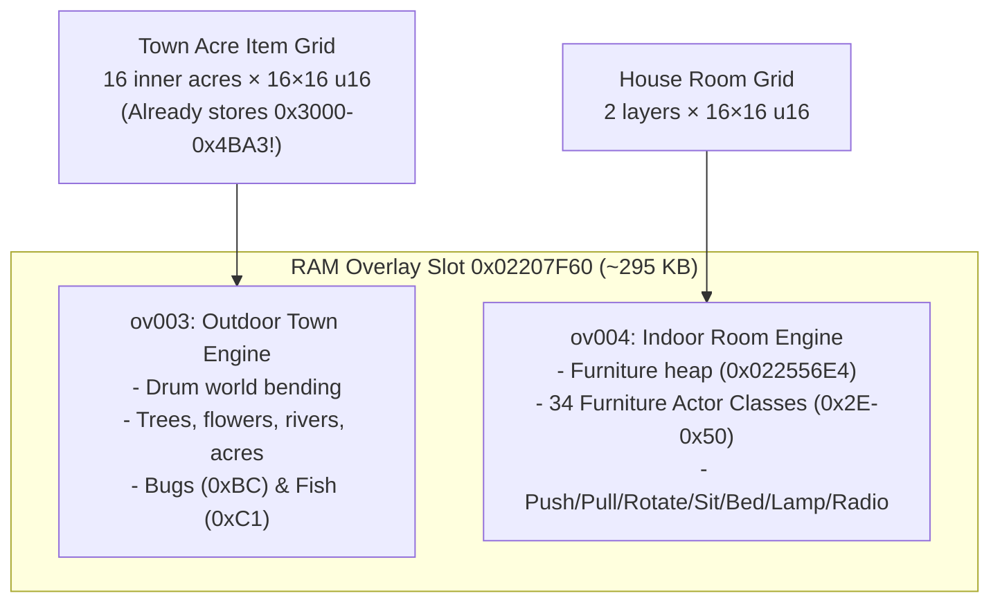

# AC:WW ROM Hacking & Outdoor Furniture Feasibility Guide

This document covers the architectural differences between a **ROM Hack**, a **Decompilation**, and a **Static Recompilation** for *Animal Crossing: Wild World* (EU, `ADMP`), along with a deep-dive technical investigation into placing and rendering furniture outdoors based on the reverse-engineering assets in `C:\NDS_RECOMP` and `E:\claudeGameDecomp`.

---

## 1. ROM Hack vs. Decomp vs. Recomp

| Dimension | Static Recompilation (`ndsrecomp`) | Decompilation (`dsd` / Matching C) | ROM Hack (`NCPatcher` / `armips`) |
| :--- | :--- | :--- | :--- |
| **Target Platform** | Native PC executable (`.exe` on x86_64) | Original Nintendo DS (`.nds`) or portable C | Original Nintendo DS (`.nds` on Emulator / Flashcart / DSi / 3DS) |
| **How it Works** | Mechanically translates ARM9/ARM7 machine code to C banks (`generated/recomp`) linked with a PC hardware runner (`nds_runner`). | Rewrites every assembly function into human-readable C/C++ that compiles with Metrowerks CodeWarrior (`mwccarm`) to the **exact same bytes**. | Leaves 99.9% of the original `.nds` binary untouched. Injects small compiled C/C++ or ARM assembly hooks into specific memory addresses or overlays, and/or edits files in the NitroFS filesystem. |
| **Scope of Effort** | Medium-High (compiler bring-up, indirect jumps, hardware timing parity) — **Already completed for AC:WW!** | Massive (years of manual matching for 29,332 functions across 148 overlays). | **Very Small to Medium** — You only write the code for the exact feature you are changing and hook the 3–10 functions it interacts with. |
| **Hardware Limits** | **Unlimited** PC RAM (GBs), CPU speed, and storage, though the guest game still sees a simulated 4 MB DS RAM unless you bypass it in C/Rust. | Bound by strict NDS hardware limits (4 MB RAM, VRAM banks, 2048 polygon/frame limit). | **Bound by strict NDS hardware limits**: 4 MB Main RAM (`0x02000000–0x023FFFFF`), ~656 KB VRAM, DS 3D hardware limit of **2,048 polygons / 6,144 vertices per frame**, and fixed overlay RAM slots. |

### Why Mario Kart DS Has Thousands of ROM Hacks Without a Full Decomp
In NDS modding, a **ROM Hack** treats the original game binary (`arm9.bin` and `arm9_overlays/ovXXX.bin`) like an already-compiled library or operating system:
1. **Asset Replacement (NitroFS):** Using tools like `dsrom` or `ndstool`, modders unpack the `.nds` filesystem (`files/`), edit tracks, models (`.nsbmd`), textures (`.nsbtx`), or text (`.bmg`), and repack the `.nds`.
2. **Code Injection (`NCPatcher` / `armips` / `Fireflower`):** When modders want to change *gameplay rules*, they don't decompile the whole game. They find the exact function address in Ghidra (e.g., `ov003::02220b90`), write a 20-line C++ function, and tell **NCPatcher** to:
   - Place a branch instruction (`bl my_custom_hook`) at `0x02220B90`.
   - Append the compiled `my_custom_hook` machine code to the end of `ov003.bin` (if there is slack space in its RAM slot) or into a custom/expanded overlay.
   - Link against the symbol list (`symbols.txt`) so your C code can directly call vanilla game functions like `drum_bend_position(pos, out)` or `item_icon_id(item)`!

> [!TIP]
> **Your Recomp is a Superpower for ROM Hacking:** Usually, the hardest part of NDS ROM hacking is **finding the functions, struct offsets, and overlay boundaries** by staring at unnamed raw assembly in Ghidra. Because your `C:\NDS_RECOMP` project has already named **15,838 functions (54.0% of the binary)**, mapped **100% of the 138 code overlays**, decoded **96.6% of the save file**, and dumped complete annotated C pseudocode for the indoor and outdoor engines, you have already finished **90% of the reverse-engineering work** required to make a ROM hack!

---

## 2. Feasibility & Complexity: "Place Furniture Outside"

### Wait—Why Doesn't Furniture Appear Outside in Vanilla AC:WW?
In vanilla *Animal Crossing: Wild World*, when you select a furniture item in your pockets and choose **"Drop"** (`ov096_act_drop`):
1. **Item IDs Are Already Furniture IDs:** Furniture items in your pocket and on the ground have IDs in Category 3 and 4 (`0x3000–0x4BA3`), encoded as `0x3000 + (model_index << 2) + facing` (`0..3`).
2. **The Indoor vs. Outdoor Pocket Branch (`ov096::0229a10c`):**
   When you drop an item from your pockets ([`func_ov096_0229a10c`](file:///C:/NDS_RECOMP/prototype/runs/2026-10-16-night/N5/work/HP/res/ov096.c#L3110-L3168)), the game checks the byte at **`*0x020E4E00`** (`0` = outdoors, `!= 0` = indoors):
   - **Indoors (`*0x020E4E00 != 0`):** It calls [`func_ov097_0229ee9c`](file:///C:/NDS_RECOMP/prototype/runs/2026-10-16-night/N5/work/HP/res/ov097.c#L27-L78), which calls `ov004_player_place_furniture` (`0x02237600`) and `ov004_furniture_kind_to_actor` (`0x02238720`) to spawn a 3D furniture actor (`ov004_piece_*`, profile `0x2E–0x50`).
   - **Outdoors (`*0x020E4E00 == 0`):** It calls `func_02042d8c` to drop the raw `0x3xxx` / `0x4xxx` furniture ID directly into the **16×16 outdoor acre item grid** (at save offset `0xC354`, RAM `0x021E6D4C`)!
3. **Why Dropped Outdoor Furniture Draws as a Green Leaf:**
   Even though the town grid *already stores the exact furniture ID (`0x3000–0x4BA3` including its facing!)*, look at the outdoor field renderer [`ov003_item_draw_loop`](file:///C:/NDS_RECOMP/prototype/runs/2026-10-16-night/N4/work/ov003.c#L24688-L24729) (`ov003::02220b90`):
   ```c
   switch ((uVar5 & 0xF000) >> 12) {
   case 0:
       // Draws 3D models for trees, flowers, weeds, rocks, holes, stumps...
       break;
   case 1: // Pocket items (0x1000-0x1FFF)
   case 3: // Furniture (0x3000-0x3FFF)
   case 4: // Furniture / Gyroids (0x4000-0x4FFF)
       local_134[2] = item_icon_id(local_a4); // Returns 0x16 (Leaf icon!) for furniture
       ov003_item_render(ctx, *(ctx + icon_id * 4 + 0x50), ...);
   }
   ```
   **That's the smoking gun!** Outdoors, Categories 3 and 4 (`0x3000–0x4BA3`) are intentionally grouped with Category 1 (`0x1xxx`) and drawn using their flat 3D floor icon (`item_icon_id` = green leaf) instead of loading their `/ftr/%d/%d/%04x.arc` 3D model!

---

### The Core Architectural Bottleneck on Real NDS Hardware
Why did Nintendo render furniture as leaves outdoors in *Wild World* (and only allow outdoor furniture 15 years later in *New Horizons*, or via small hacks in *New Leaf*)? **Three hardware & engine reasons:**



1. **`ov003` and `ov004` Share the Exact Same RAM Address (`0x02207F60`):**
   - `ov003` (Outdoor Engine, `0x02207F60–0x0225F320`) and `ov004` (Indoor Engine, `0x02207F60–0x02255B54`) occupy the same overlay slot!
   - All 34 furniture actor classes (`ov004_piece_*`, profiles `0x2E–0x50`), the furniture heap (`0x022556E4`), the push/pull/rotate state machines, and the sit/lie/switch logic live inside **`ov004`**, which is **unloaded when you are outside**!
2. **Drum Curvature ("World Bending"):**
   - Indoors (`ov004`), the floor is flat (`y = 0`). [`func_ov004_0220bcfc`](file:///E:/claudeGameDecomp/docs/ADDRESSES-FURNITURE.md#L26) simply translates a piece to `(col*2+1, y, row*2+1)` and rotates around Y by `(item & 3) << 14`.
   - Outdoors (`ov003`), the town sits on a curved cylinder ("the drum"). Every outdoor object must call [`drum_bend_position(&bent_pos, &world_pos)`](file:///E:/claudeGameDecomp/docs/ADDRESSES-ARM9-TOWN.md#L7) (`0x0203F060`) and `mtx_rotate_x_model(mtx, drum_angle)` before applying its Y-rotation!
3. **NDS Heap, VRAM, and Polygon Budgets:**
   - Each furniture model (`/ftr/{m>>8}/{(m&0xFF)>>4}/{m:04x}.arc` + `.nsbtx`) must be loaded from NitroFS into heap memory, and its textures uploaded to VRAM.
   - Outdoors, the DS is already rendering pre-bent acre meshes, river water, buildings, trees, flowers, and villagers. However, `ov003` only draws items within a visible window around the camera (`local_134[5]` rows `-14..4`, `local_134[4]` cols `-9..9`, max 252 items).

---

### The 3 Tiers of "Place Furniture Outside" ROM Hacks

Depending on how interactive you want outdoor furniture to be, the complexity ranges from a **weekend hack** to an **advanced engine mod**:

#### Tier 1: Visual & Solid 1×1 Outdoor Furniture ("The Model Swap + Collision Hack") — **HIGHLY FEASIBLE (Low–Medium Complexity)**
Instead of porting all 34 indoor actor classes (`ov004`) to the town, you keep the town's existing tile-grid architecture and upgrade how `ov003` treats item IDs `0x3000–0x4BA3`:
- **How it works:**
  1. **Save Format Compatibility (100% Free!):** The town grid (`0xC354`) *already* saves `0x3000–0x4BA3` (where the bottom 2 bits `item & 3` store the 4-way rotation!). You can even set the facing bit when dropping the item based on the player's facing angle (`*(short *)(player + 0x8E)`).
  2. **Model Cache in `ov003`:** Write a small LRU model/texture cache (e.g., caching up to 8–16 distinct furniture `.arc` + `.nsbtx` models in heap memory using main's `0x02054E98` model loader) and hook [`ov003_item_draw_loop`](file:///C:/NDS_RECOMP/prototype/runs/2026-10-16-night/N4/work/ov003.c#L24688-L24729) (`case 3:` / `case 4:`). If the furniture model is loaded in the cache, render the 3D furniture model on the curved drum (with `drum_bend_position`, `mtx_rotate_x_model`, and `mtx_rotate_y` by `(item & 3) << 14`); if the cache is full, fall back gracefully to the leaf icon.
  3. **Collision Cylinder:** In main (`item_collision_shape` / U2's category-0 cylinder check), add `0x3000–0x4BA3` to the solid collision check so players and villagers walk around placed furniture instead of walking through it.
  4. **Picking It Back Up:** Because it is still a grid item on the tile in front of you, pressing **Y** (pick up) works out of the box!

#### Tier 2: Multi-Tile Footprints (`1×2`, `2×1`, `2×2`) & Rotation — **FEASIBLE (Medium Complexity)**
- **How it works:**
  - `ftr_info/<lang>/always.bin` (`+5`, read by `0x02053404`) already exists in `main`! It tells you whether a furniture item is `1×1` (0), `2×1` (1), or `2×2` (2).
  - Moreover, U2 (`runs/2026-10-15-u0/u2/README.md`) discovered that item ID **`0xF031`** is already grouped with furniture in the game's item-range classifiers as a "secondary covered tile" marker (just like `0xF030` covers building footprints)!
  - When dropping a `2×1` or `2×2` item outdoors, your hook checks that the adjacent footprint tiles are `0xFFF1` (empty), writes the anchor `0x3xxx` ID to the primary tile, and writes `0xF031` to the secondary tiles (and clears them when picked up).

#### Tier 3: Full Indoor Actor Interactivity Outdoors (Push/Pull, Sit on Chairs, Lie on Beds, Turn on Lamps/Radios, Table Top Layer) — **HARD (High Complexity)**
- **Why it's much harder in a ROM hack:**
  - The town grid (`0xC354`) only has **1 layer** of `u16` per acre (`16×16`), whereas indoor rooms have **2 layers** (floor + tabletop). Putting a lamp on a table outdoors would require stealing unused save bytes (or repurposing the `buried_bits` / unknown save padding) to store a second layer.
  - Sitting, lying down, pushing/pulling, and animated furniture states (lamps, radios, TVs, clocks) rely on **47 indoor player action IDs** (`action_table.json`) and **34 `ov004` actor classes** that are not in RAM when `ov003` is loaded. You would have to extract the base `ov004_piece` logic and re-compile it into a custom overlay or `ov003` extension, plus port the drum-bending math into every furniture piece's draw and collision routine.

> [!IMPORTANT]
> **Wait — ROM Hack vs. Recomp Mod:**
> If your goal is to play on a **real Nintendo DS / flashcart / mobile emulator**, **Tier 1 (and Tier 2)** is the sweet spot for a ROM hack: it fits cleanly into NDS RAM/VRAM limits and takes only a few hundred lines of C hooked into `ov003` and `main`.
> On the other hand, if you ever want **Tier 3** (unlimited furniture, tabletop stacking, full animations, zero lag, plus terraforming), doing it *inside your PC Recomp* (via function replacement / Strategy C) avoids every single NDS memory and overlay slot limitation!

---

## 3. How to Leverage Your `C:\NDS_RECOMP` Progress for a ROM Hack

Your existing workspace (`C:\NDS_RECOMP` and `E:\claudeGameDecomp`) gives you an unprecedented toolkit for NDS ROM hacking. Nothing in `C:\NDS_RECOMP` needs to be modified — we can reference its files directly from `e:\acww-plus`.

### A. Ready-to-Use Code, Symbols & Decompiled C
1. **Complete Symbol & Relocation Maps:**
   - `C:\NDS_RECOMP\prototype\runs\2026-10-15-u0\namestore\` (and the merged night sprint symbols) contains **15,838 named functions** in `dsd` format.
   - We can convert this `symbols.txt` directly into a **GCC linker script (`.ld`)** or **`armips` symbol file** in `e:\acww-plus`. That means in your ROM hack's C code, you can simply call `drum_bend_position(...)`, `item_icon_id(...)`, or `town_item_on_tile(...)` by name, and the linker will resolve the exact ARM9/Thumb address automatically!
2. **Full Annotated Decompiles (`ov003.c`, `ov004.c`, `ov096.c–ov098.c`, `all.ann`):**
   - `C:\NDS_RECOMP\prototype\runs\2026-10-15-u0\u1\gh\all.ann` (the entire game decompiled with literal pools resolved)
   - [`N3\work\ov004.c`](file:///C:/NDS_RECOMP/prototype/runs/2026-10-16-night/N3/README.md) (Indoor furniture engine)
   - [`N4\work\ov003.c`](file:///C:/NDS_RECOMP/prototype/runs/2026-10-16-night/N4/work/ov003.c) (Outdoor town engine & item draw loop)
   - [`N5\work\HP\res\ov096.c`](file:///C:/NDS_RECOMP/prototype/runs/2026-10-16-night/N5/work/HP/res/ov096.c), [`ov097.c`](file:///C:/NDS_RECOMP/prototype/runs/2026-10-16-night/N5/work/HP/res/ov097.c), [`ov098.c`](file:///C:/NDS_RECOMP/prototype/runs/2026-10-16-night/N5/work/HP/res/ov098.c) (Pocket menus)
3. **Machine-Readable Schemas:**
   - [`town_schema.json`](file:///C:/NDS_RECOMP/prototype/runs/2026-10-15-u0/u2/README.md) (40 item ranges, 124 tile collision kinds, placement rules)
   - [`items.json`](file:///C:/NDS_RECOMP/prototype/runs/2026-10-15-u0/u4a/README.md) (all 1,769 furniture models `0x3000–0x4BA3` and footprints)
   - [`save_schema_v2.json`](file:///C:/NDS_RECOMP/prototype/runs/2026-10-16-night/N1/README.md) & [`acww_save_edit.py`](file:///C:/NDS_RECOMP/animalcrossingwwrecomp/tools/acww_save_edit.py) ( lets us instantly inject furniture items into a test save's pockets for rapid testing!).

### B. Automated Testing & Debugging with `ndsref` and Scenarios
In traditional ROM hacking, testing a change means booting an emulator, clicking through the title screen, walking out of your house, opening pockets, and dropping an item manually every single time.
With your recomp tools:
- **Instant Save Editing:** [`acww_save_edit.py`](file:///C:/NDS_RECOMP/animalcrossingwwrecomp/tools/acww_save_edit.py) can put any furniture item (e.g. `--add-item 0x3000`) into Player 0's pockets in 0.1 seconds.
- **Headless Deterministic Replay (`ndsref` + `scenarios/`):** Your oracle emulator `C:\NDS_RECOMP\ndsref\build-native\ndsref.exe` (and `DeSmuME` oracle) accepts any `.nds` ROM via `--rom` and can replay recorded input scenarios (like `acww_pockets_outside.json` or session `s001`) to a specific frame, dump screenshots, inspect RAM, or break at any PC (`run_to_pc`)!

### C. Where Will Our Custom Code Live in RAM?
Thanks to U3's overlay map ([`u3/README.md`](file:///C:/NDS_RECOMP/prototype/runs/2026-10-15-u0/u3/README.md)), we know the exact memory layout of every overlay slot when the player is outdoors:
- **`ov003` (`0x02207F60–0x0225F0E8`)** ends right before the outdoor hook slot (`0x0225F320`), leaving **`0x238` bytes (568 bytes)** of slack space at the end of `ov003`.
- **The Special NPC Slot (`0x02274F80–0x02295480`, ~132 KB!)** or **Unused Dummy Overlays (`ov000`, `ov057–ov064`, `ov089` — 10 completely empty 32-byte overlays in the ROM!)**:
  - Wait—look at [`u3/README.md` line 23](file:///C:/NDS_RECOMP/prototype/runs/2026-10-15-u0/u3/README.md#L23): **10 overlays (`ov000`, `ov057–064`, `ov089`) contain 32 zero bytes and are never loaded by the game!**
  - Even better, we can check if there is free space at the end of `ov003` or `ov009` (`0x0225F440–0x02262D60`), or repurpose one of the 10 empty overlays (`ov000`) mapped into unused heap/RAM space so our custom C code has plenty of room without colliding with anything!
